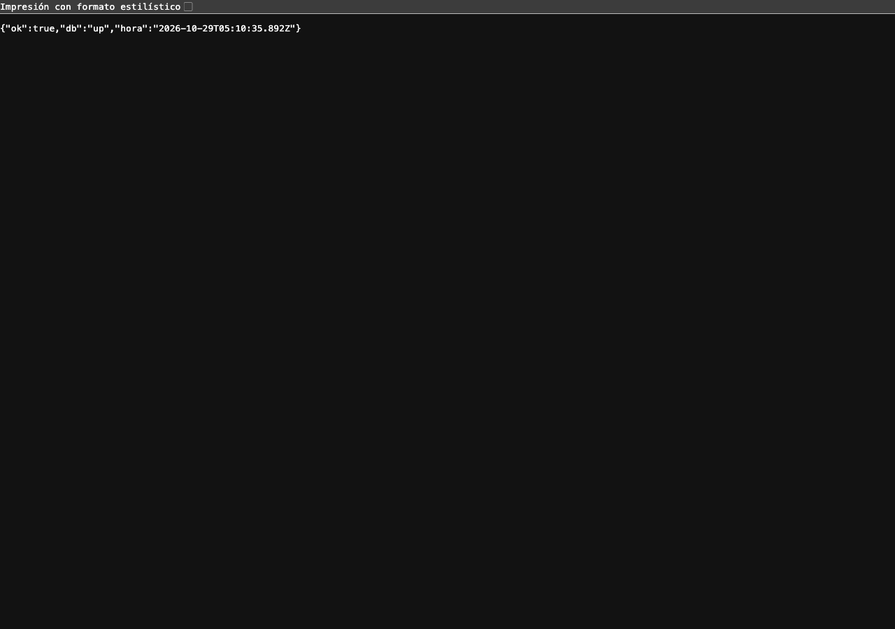
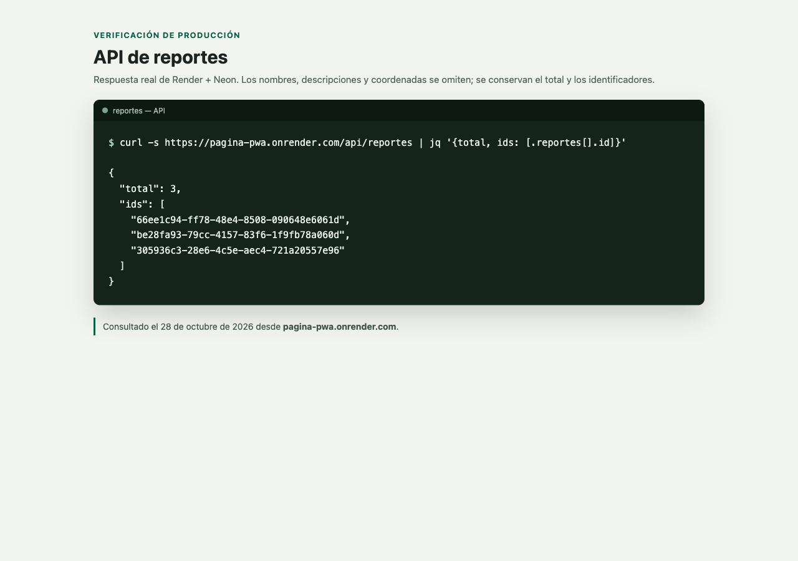
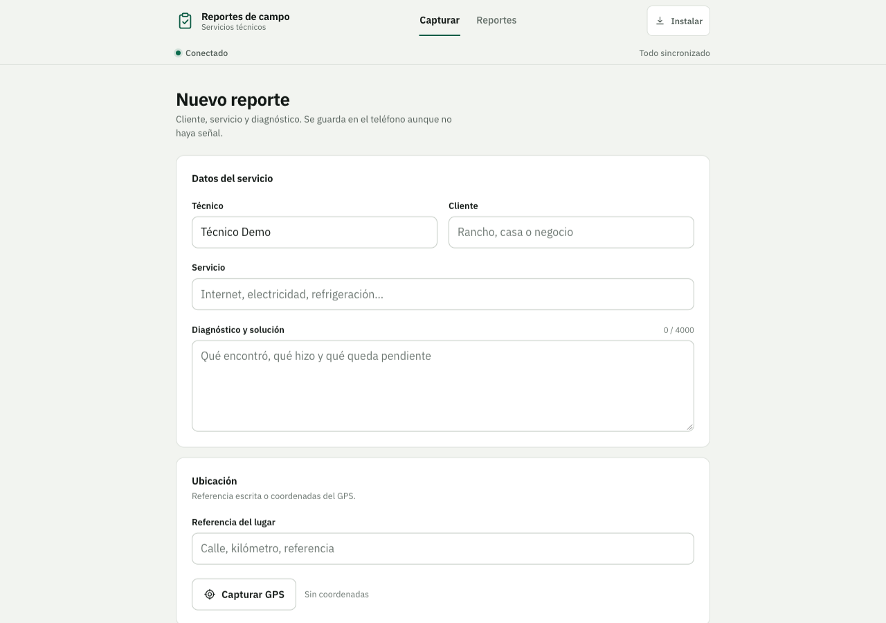
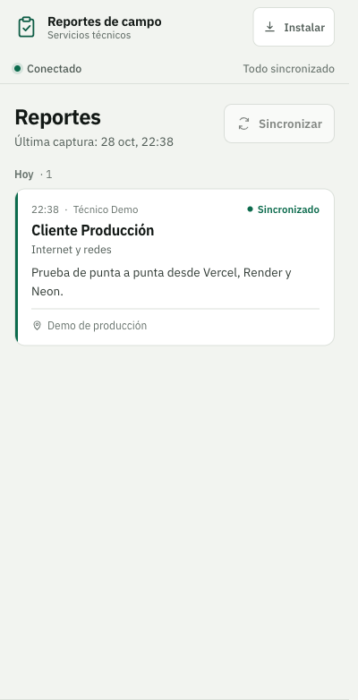
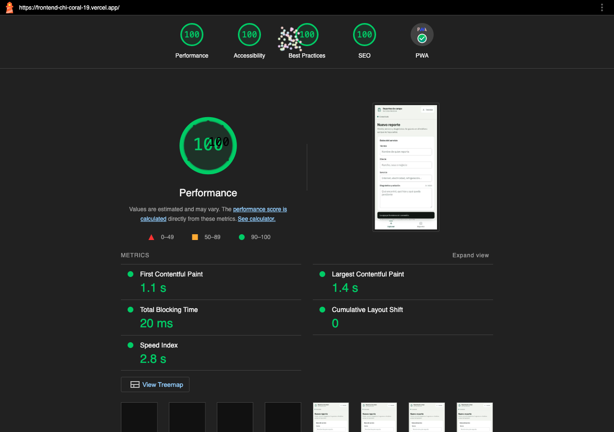

# Reportes Técnicos de Campo — PWA

PWA offline-first para que técnicos de servicios registren reportes en zonas rurales **sin internet** y los sincronicen al recuperar la señal, desde Android o iOS, sin instalar nada desde una tienda.

**Proyecto integrador UTM.** Este es el documento único del proyecto: reúne la arquitectura, la compatibilidad, el avance por sprints, el despliegue, la verificación y el guion de demostración. Las evidencias visuales están en [`docs/evidencias/`](docs/evidencias/).

## Estado actual

| Pieza | Estado |
| --- | --- |
| Entorno Docker (web + API + PostgreSQL) | Funcionando |
| API REST idempotente | Funcionando y probada |
| UI móvil (captura + listado) | Rediseñada y verificada |
| Manifest + instalación | Implementado; verificado en Android por Ngrok y en producción. iOS sin dispositivo físico |
| Service Worker (precache, SWR, `offline.html`) | Funcionando en local y producción |
| Guardado offline + sincronización automática/manual | Funcionando; demostrado desde producción |
| Persistencia en PostgreSQL/Neon | Verificada, incluida la supervivencia a un reinicio de Render |
| Lighthouse (PWA, rendimiento, accesibilidad, buenas prácticas, SEO) | 100 / 100 / 100 / 100 / 100 |
| Despliegue en Neon + Render + Vercel | Funcionando con HTTPS y persistencia real |
| Prueba en Android real | Verificada en hardware y en producción |
| Prueba en iOS real | No realizada: no hay dispositivo disponible. Compatibilidad implementada y limitación documentada |

## Cumplimiento de la rúbrica

Estimación interna usando los pesos del documento de la asignatura.

| Criterio | Peso | Cobertura | Puntos | Evidencia principal |
| --- | ---: | ---: | ---: | --- |
| Análisis arquitectónico | 20% | 100% | 20/20 | Comparación de cinco alternativas, matriz y justificación de la PWA |
| Entorno y configuración | 15% | 100% | 15/15 | Docker, Node, Vite, DevTools, Ngrok, API y capturas HTTPS |
| Instalabilidad y compatibilidad | 20% | 85% | 17/20 | Manifest, Android real, flujo iOS implementado y documentado |
| Capacidad offline | 30% | 100% | 30/30 | Service Worker, Dexie, cola de sincronización y video del modo avión |
| Calidad tecnológica | 15% | 100% | 15/15 | Lighthouse PWA 100 y despliegue en Neon + Render + Vercel |
| **Total** | **100%** | **97%** | **97/100** | Proyecto listo para defensa; falta la prueba física en iOS |

**Por qué no se marca 100%:** la rúbrica pide prueba de instalación real en al menos dos navegadores. Android se probó en hardware; iOS tiene el flujo implementado y documentado, pero no se verificó físicamente porque no hay dispositivo. Si la evaluación acepta la evidencia documental de iOS, ese criterio sube a 100% y el total también.

## Producción

| Servicio | URL |
| --- | --- |
| App (Vercel) | <https://frontend-chi-coral-19.vercel.app/> |
| API (Render) | <https://pagina-pwa.onrender.com> |
| Salud de la API | <https://pagina-pwa.onrender.com/api/health> |
| Reportes | <https://pagina-pwa.onrender.com/api/reportes> |
| Lighthouse público | [`docs/evidencias/lighthouse-produccion.html`](docs/evidencias/lighthouse-produccion.html) |
| Capturas y video | [`docs/evidencias/`](docs/evidencias/) |

La base de datos vive en Neon. El frontend llama a Render mediante `VITE_API_URL` y Render solo acepta el origen de Vercel configurado en `CORS_ORIGIN`.

## Problema y requerimientos

El técnico trabaja en rancherías o zonas rurales donde la señal es intermitente. Si el formulario depende de la red, el reporte se pierde o se duplica al reintentar. La solución guarda primero en el dispositivo y sincroniza después.

| ID | Requerimiento | Prioridad | Criterio de aceptación |
| --- | --- | --- | --- |
| R1 | Registrar un reporte sin red y no perderlo | Crítico | Sin conexión, el reporte aparece como pendiente y sigue ahí después de recargar |
| R2 | Sincronizar al recuperar conexión sin duplicar | Crítico | Reenviar el mismo UUID devuelve 200 y no crea una segunda fila |
| R3 | Instalarse desde una URL en Android e iOS | Crítico | Chrome Android muestra la instalación; Safari iOS permite agregar a inicio con una guía |
| R4 | Coste y tiempo de desarrollo bajos | Alto | Una base de código, sin tiendas y con despliegue por `git push` |
| R5 | Funcionar en hardware heterogéneo | Alto | La interfaz responde entre 320 px y 1440 px sin desbordamiento |
| R6 | Capturar GPS y permitir una referencia manual | Medio | El botón GPS obtiene coordenadas; si se deniega el permiso, el campo escrito sigue disponible |
| R7 | Actualizar sin revisión de tienda | Medio | Un despliegue nuevo se publica con una URL y el Service Worker actualiza el shell |

## Decisión arquitectónica

Se compararon cinco alternativas: web tradicional, orientada a servicios (API), nativa, multiplataforma y PWA. La matriz ponderada dio estos totales:

| Alternativa | Total | Lectura |
| --- | ---: | --- |
| **PWA** | **4.78** | Gana en offline, coste, instalación y despliegue; pierde en acceso profundo a hardware |
| Multiplataforma | 3.78 | Buen acceso a hardware, pero exige tiendas, revisión y más mantenimiento |
| Nativa | 2.80 | Mejor rendimiento y hardware, pero dos códigos, dos tiendas y mayor coste |
| Web tradicional | — | No cumple el requisito offline ni la instalación |
| SOA/API | — | La API sigue en el servidor, pero el cliente delgado colapsa sin red |

**Decisión:** PWA con Vite + JavaScript, `vite-plugin-pwa` en modo `injectManifest`, Dexie sobre IndexedDB, Express y PostgreSQL. La PWA conserva la API en el servidor y añade una capa local que permite trabajar sin conexión.

### Por qué esta combinación

- **Offline-first, no offline tolerante.** La red es un acelerador; el guardado ocurre en el dispositivo.
- **UUID en el cliente + `ON CONFLICT (id) DO UPDATE`.** Reintentar cinco veces no duplica: la clave primaria es el mismo UUID.
- **`injectManifest`.** El `sw.js` es código propio con `install`, `activate` y `fetch` visibles; Vite solo inyecta los hashes.
- **Stale-While-Revalidate** para CSS, JS, imágenes y fuentes: responde desde caché y actualiza en segundo plano.
- **`NetworkOnly` para `/api/`.** Cachear reportes produciría datos fantasma.
- **`offline.html`** para rutas de navegación no cacheadas; `/` siempre cae al shell precacheado.
- **iOS sin `beforeinstallprompt` ni Background Sync.** Se resuelve con un modal de instalación guiado, botón manual y el evento `online`.

## Arquitectura

```text
┌──────────────────────────── teléfono ────────────────────────────┐
│  UI (HTML/CSS/JS)                                                │
│      │ guardar                                                   │
│      ▼                                                           │
│  IndexedDB (Dexie)  ── pending ──▶  syncPending()  ──POST──▶ API │
│      ▲                                   │                       │
│      └──────────── synced ◀──────────────┘                       │
│                                                                  │
│  Service Worker: shell precacheado + SWR para estáticos          │
└──────────────────────────────────────────────────────────────────┘
                                   │
                          PostgreSQL / Neon
```

### Flujo de un reporte

1. El técnico llena el formulario y pulsa **Guardar reporte**.
2. Se genera un UUID con `crypto.randomUUID()` **en el cliente**.
3. El reporte se escribe en IndexedDB con `syncStatus: 'pending'`. Esto nunca depende de la red.
4. Si hay conexión, se intenta enviar de inmediato. Si no, la UI avisa: «Reporte guardado. Se enviará al reconectar».
5. Al volver la red (evento `online`), al abrir la app o al pulsar **Sincronizar**, se envían los `pending`.
6. El servidor responde 201 (nuevo) o 200 (ya existía) y el registro local pasa a `synced`.

### Componentes

| Componente | Responsabilidad |
| --- | --- |
| `frontend/src/main.js` | UI, formulario, GPS, instalación, estados de red y sincronización |
| `frontend/src/db.js` | Dexie/IndexedDB: reportes y preferencia del técnico |
| `frontend/src/sync.js` | Cola idempotente y guardia contra sincronizaciones concurrentes |
| `frontend/src/sw.js` | Ciclo de vida del Service Worker, precache, SWR y fallback offline |
| `backend/src/server.js` | Express, CORS, health check y manejo de errores |
| `backend/src/routes/reportes.js` | `GET` y `POST` idempotente |
| `backend/src/db.js` | Pool de `pg` con SSL para Neon |
| `backend/sql/schema.sql` | Tabla `reportes`, índices y restricciones |

### Modelo de datos

| Campo | Tipo | Uso |
| --- | --- | --- |
| `id` | UUID | Clave primaria generada en el cliente; permite reintentos seguros |
| `tecnico` | Texto | Nombre del técnico |
| `cliente` | Texto | Cliente o sitio |
| `servicio` | Texto | Tipo de servicio |
| `descripcion` | Texto | Diagnóstico o trabajo realizado |
| `ubicacion` | Texto | Referencia manual |
| `lat`, `lng` | Numérico | Coordenadas GPS opcionales |
| `fecha_creacion` | Timestamp | Se conserva en las actualizaciones |
| `fecha_actualizacion` | Timestamp | Última escritura |

## Sprints y fases abarcadas

El proyecto se organizó en cuatro sprints. Cada uno deja código, una decisión documentada y una evidencia verificable.

### Sprint 1 — Diagnóstico, arquitectura y compatibilidad

**Fases abarcadas**

- Análisis del problema y de los usuarios (técnicos en campo, Android e iOS).
- Siete requerimientos funcionales con criterios de aceptación.
- Comparación de cinco alternativas y matriz ponderada.
- Selección de la PWA y definición de la arquitectura.
- Matriz de compatibilidad Chromium/WebKit: instalación, persistencia, Background Sync, push, GPS y cuota.
- Checklist de instalación para Android e iOS.

**Resultado**

- PWA seleccionada con 4.78 frente a 3.78 de la alternativa multiplataforma.
- Límites de iOS identificados antes de programar: sin `beforeinstallprompt`, sin Background Sync y posible purga por ITP.
- Decisión de usar un flujo de instalación propio y un botón manual de sincronización.

**Qué abarcaría una siguiente iteración**

- Prueba física en iPhone y iPad.
- Autenticación y roles de técnico/supervisor.
- Política de retención y respaldo de datos.

### Sprint 2 — Entorno, API y persistencia

**Fases abarcadas**

- Repositorio y entorno reproducible con Docker Compose.
- Frontend Vite, backend Express y PostgreSQL.
- Esquema de la tabla `reportes` y migración idempotente.
- API REST: salud, listado y alta idempotente.
- CORS cerrado por origen.
- Túnel HTTPS con Ngrok para probar en teléfonos reales.
- Prueba funcional en Android real.

**Resultado**

- `docker compose up --build -d` levanta web, API y base de datos.
- `GET /api/health` responde `{"ok":true,"db":"up"}`.
- `POST /api/reportes` responde 201 para un reporte nuevo y 200 para el mismo UUID.
- El frontend usa `/api` en local y `VITE_API_URL` en producción.

**Qué abarcaría una siguiente iteración**

- Pruebas automatizadas de API y de integración.
- Migraciones versionadas y respaldos programados.
- Límite de peticiones y observabilidad del backend.

### Sprint 3 — Núcleo PWA, interfaz y offline

**Fases abarcadas**

- Interfaz mobile-first con formulario, GPS, listado y estados de sincronización.
- Manifest, íconos, colores, modo `standalone` y metadatos iOS.
- Service Worker propio con `install`, `activate`, precache, SWR y `offline.html`.
- Persistencia local con Dexie/IndexedDB.
- Cola de sincronización automática y manual.
- Idempotencia de extremo a extremo.
- Corrección del guardado cuando `localStorage` falla o está bloqueado.
- Tipografía IBM Plex Sans autoalojada y precacheada.

**Resultado**

- La app abre sin red y conserva los reportes pendientes tras recargar.
- Al recuperar la conexión, los reportes pasan a **Sincronizado** sin duplicarse.
- Build de producción con 11 entradas precacheadas (250.73 KiB).
- Sin desbordamiento horizontal entre 320 px y 1440 px.
- Controles principales de 44 px o más; enlaces de al menos 24 px.
- Instalación verificada en Android; instalación guiada implementada para iOS.

**Qué abarcaría una siguiente iteración**

- Background Sync donde el navegador lo soporte, además del disparo actual por `online`.
- Resolución de conflictos si el mismo reporte se edita en dos dispositivos.
- Adjuntar fotos y firmas con compresión y cuota controlada.
- Notificaciones push y recordatorios de sincronización.

### Sprint 4 — Producción, auditoría y cierre

**Fases abarcadas**

- PostgreSQL en Neon con el esquema aplicado.
- API en Render con Docker, health check y variables de entorno.
- Frontend en Vercel con `VITE_API_URL` y cabeceras para `sw.js` y el manifest.
- CORS de producción cerrado al dominio de Vercel.
- Verificación de persistencia, idempotencia y recarga sin red.
- Auditoría Lighthouse sobre la URL pública.
- Evidencias de API, instalación, reporte sincronizado, Ngrok y modo avión.
- Guion de demostración y respuestas a preguntas probables.

**Resultado**

- App y API publicadas con HTTPS.
- Tres reportes persistidos en Neon; dos capturados desde Android en producción.
- Reenvío del mismo UUID: 200 y total sin cambios.
- Persistencia comprobada después de reiniciar Render.
- Lighthouse 11: PWA 100, accesibilidad 100, buenas prácticas 100, rendimiento 100 y SEO 100.
- Demostración de producción y modo offline ensayadas.

**Qué abarcaría una siguiente iteración**

- Dominio propio y monitorización de disponibilidad.
- Respaldos automáticos y alertas de errores.
- Prueba física en iOS y en un segundo navegador de escritorio.
- Panel de administración para supervisores.

## Funcionamiento offline

1. El shell de la app se precarga en la instalación del Service Worker.
2. Los assets estáticos se sirven con Stale-While-Revalidate.
3. Las llamadas a `/api/` van siempre a la red; nunca se cachean.
4. El reporte se guarda en IndexedDB antes de intentar el `POST`.
5. Si no hay red, queda como **Pendiente de sincronizar**.
6. Al volver `online`, abrir la app o pulsar **Sincronizar**, se envía la cola.
7. El `POST` usa el UUID del cliente y `ON CONFLICT` para evitar duplicados.
8. Si el servidor responde 200 o 201, el registro local pasa a **Sincronizado**.

### Prueba de modo avión

1. Abre <http://localhost:5173> y espera a que el navegador registre el Service Worker (DevTools → Application → Service Workers).
2. DevTools → Network → **Offline**.
3. La franja de estado debe mostrar el punto rojo y «Trabajando sin conexión».
4. Captura un reporte. Aparece como **Pendiente de sincronizar** y el contador de la pestaña sube.
5. Recarga la página: la app sigue abriendo y el reporte sigue ahí.
6. Vuelve a **Online**. En segundos el reporte pasa a **Sincronizado**.
7. Compruébalo en la base:

```sh
curl -s localhost:3000/api/reportes | python3 -m json.tool
```

El recorrido grabado está en [`docs/evidencias/demo-modo-avion.mp4`](docs/evidencias/demo-modo-avion.mp4). El póster está en [`docs/evidencias/demo-modo-avion-poster.jpg`](docs/evidencias/demo-modo-avion-poster.jpg).

## Compatibilidad e instalación

| Característica | Chromium / Chrome Android | WebKit / Safari iOS | Decisión en el proyecto |
| --- | --- | --- | --- |
| Instalación | `beforeinstallprompt` disponible; prompt nativo | No existe el evento; se usa **Compartir → Agregar a inicio** | Botón propio en Android y diálogo con los tres pasos en iOS |
| Detección de app instalada | `matchMedia('(display-mode: standalone)')` | `navigator.standalone` además del modo de visualización | Detección combinada para no mostrar la ayuda dos veces |
| Persistencia | IndexedDB con cuota amplia; `navigator.storage.persist()` | ITP puede purgar el almacenamiento de sitios sin interacción; las PWA instaladas están exentas | Instalar, sincronizar pronto y ofrecer sincronización manual |
| Sincronización en segundo plano | Background Sync disponible | No disponible | Evento `online`, apertura de la app y botón manual |
| Push | Web Push con permiso | Web Push limitado y sujeto a instalación | Fuera del alcance actual |
| GPS | Geolocation API | Geolocation API con permiso | Botón GPS y campo manual de respaldo |
| Service Worker | Soportado | Soportado en iOS 11.3+ | Mismo `sw.js`; cambia el disparo de sincronización |
| Cuota | Alta y persistente | Sujeta a ITP | Aviso de estado pendiente y sincronización temprana |

### Checklist de instalación

**Android / Chrome**

1. Abre la URL de producción.
2. Espera el botón **Instalar** o el aviso del navegador.
3. Instala y abre la app desde el icono.
4. Comprueba que se abre en modo `standalone`, sin la barra del navegador.

**iOS / Safari**

1. Abre la URL en Safari.
2. Toca **Compartir**.
3. Elige **Agregar a inicio**.
4. Abre la app desde el icono.
5. Repite el flujo offline y la sincronización manual.

**Estado real:** Android quedó probado en hardware y en producción. iOS tiene el flujo implementado y documentado, pero no se probó físicamente porque no hay iPhone disponible. No se presentan capturas ni resultados simulados de iOS.

## API

Base local: `http://localhost:3000`. En la app se consume por `/api` (proxy de Vite), así un solo túnel de Ngrok cubre frontend y backend.

### `GET /api/health`

```sh
curl -s localhost:3000/api/health
# {"ok":true,"db":"up","hora":"..."}
```

### `GET /api/reportes`

Devuelve los últimos 500, más recientes primero.

```sh
curl -s localhost:3000/api/reportes
# {"total":2,"reportes":[{...},{...}]}
```

### `POST /api/reportes`

Cuerpo mínimo: `id` (UUID), `cliente`, `servicio`, `descripcion`.

```sh
curl -s -X POST localhost:3000/api/reportes \
  -H 'Content-Type: application/json' \
  -d '{
    "id": "3f2b8c1e-9d4a-4f7b-8c2e-1a5d6e7f8a9b",
    "tecnico": "Luis",
    "cliente": "Rancho El Sol",
    "servicio": "Internet y redes",
    "descripcion": "Cambio de antena",
    "ubicacion": "Km 4",
    "lat": 20.12345,
    "lng": -98.76543
  }'
```

- `201` si el reporte es nuevo (`insertado: true`).
- `200` si ya existía: actualiza campos, conserva `fecha_creacion` y no crea otra fila (`insertado: false`).
- `400` si falta el UUID o algún campo obligatorio.

## Arranque rápido

```sh
docker compose up --build -d          # web, API y base de datos
docker compose exec backend npm run migrate
```

- App: <http://localhost:5173>
- API: <http://localhost:3000/api/health>
- PostgreSQL: `localhost:5433` (usuario `pwa`, contraseña `pwa`, base `reportes`)

La primera vez que abras la app, el Service Worker se instala y precarga el shell. A partir de ahí puedes activar el modo avión y seguir trabajando.

## Stack

| Capa | Herramienta | Versión | Por qué |
| --- | --- | --- | --- |
| Entorno | Docker + Compose | 29 / v5 | Un comando levanta todo y no ensucia la máquina |
| Frontend | Vite | 7 | Build rápido, hashes automáticos, proxy `/api` en desarrollo |
| UI | HTML5 + CSS3 + JS nativo | — | Sin framework: menos peso, más control |
| Tipografía | IBM Plex Sans (autoalojada) | 5 | Una sola familia, OFL y precacheada: se ve igual sin red |
| PWA | `vite-plugin-pwa` (`injectManifest`) | 2 | `sw.js` propio y legible, con precache inyectado por Vite |
| Caché | Workbox | 7 | `precacheAndRoute`, `StaleWhileRevalidate`, `ExpirationPlugin` |
| Offline | Dexie.js sobre IndexedDB | 4 | API cómoda para IndexedDB, índices y consultas |
| Backend | Node + Express | 20 / 5 | API mínima, sin capas innecesarias |
| Datos | PostgreSQL | 16 Alpine | Integridad y `ON CONFLICT` para idempotencia |
| Driver | `pg` | 8 | Pool de conexiones y consultas parametrizadas |
| Producción | Neon + Render + Vercel | — | Capa gratuita real, HTTPS automático |
| Túneles | Ngrok | 3 | HTTPS para probar en teléfonos reales |

## Variables de entorno

| Variable | Dónde | Para qué |
| --- | --- | --- |
| `DATABASE_URL` | backend | Cadena de PostgreSQL. En Neon incluye `?sslmode=require` |
| `PORT` | backend | Puerto de escucha (3000 por defecto) |
| `CORS_ORIGIN` | backend | Dominios permitidos, separados por coma |
| `API_PROXY_TARGET` | frontend (contenedor) | A dónde manda `/api` Vite. Por defecto `http://backend:3000` |
| `VITE_API_URL` | frontend (build) | URL pública de la API. Vacío en local (mismo origen) |

No se versiona un archivo de ejemplo. Define las variables en el panel de Render/Vercel o en tu shell. `.env` y `.env.*` están ignorados; nunca subas secretos.

## Comandos

| Comando | Qué hace |
| --- | --- |
| `docker compose up --build -d` | Levanta o reconstruye los tres servicios |
| `docker compose logs -f frontend` | Logs del servidor web |
| `docker compose exec backend npm run migrate` | Crea tablas e índices |
| `docker compose exec db psql -U pwa -d reportes -c '\d reportes'` | Inspecciona la tabla |
| `docker compose down` | Detiene los contenedores (conserva datos) |
| `docker compose down -v` | Detiene y borra la base local |
| `cd frontend && npm run dev` | Desarrollo con HMR en el host (sin Service Worker) |
| `cd frontend && npm run build` | Build de producción con precache |
| `python3 frontend/scripts/generate-icons.py` | Regenera los íconos |

> El contenedor del frontend sirve el **build de producción** con `vite preview`, para que el Service Worker se comporte igual que en la nube. Si quieres editar con recarga en caliente, para el contenedor y usa `npm run dev` en `frontend/`.

## Ngrok y prueba móvil

```sh
ngrok config add-authtoken <TU_TOKEN>
ngrok http 5173
```

Abre la URL `https://…ngrok-free.app` en el teléfono. No hace falta un segundo túnel: la API viaja por `/api` gracias al proxy.

- **Android/Chrome:** aparece el botón «Instalar app».
- **iOS/Safari:** aparece «Cómo instalar», que explica Compartir → Agregar a inicio.

El plan gratuito de Ngrok muestra una página **Visit Site** la primera vez. Púlsala y recarga una vez; si no, el manifest llega como HTML y Chrome no ofrece instalar.

Si Vite responde `Blocked request`, revisa `server.allowedHosts` en `frontend/vite.config.js`.

## Despliegue

### 1. Base de datos — Neon

1. Crea un proyecto en <https://neon.tech> y copia la **Pooled connection** con `?sslmode=require`.
2. Ejecuta `backend/sql/schema.sql` desde el editor SQL de Neon.
3. Verifica con `SELECT count(*) FROM reportes;`.

### 2. Backend — Render

| Ajuste | Valor |
| --- | --- |
| Tipo | Web Service · Docker |
| Root Directory | `backend` |
| Dockerfile Path | `Dockerfile` |
| Docker Build Context | `.` (relativo a `backend`) |
| Health check | `/api/health` |
| `DATABASE_URL` | cadena Pooled de Neon |
| `CORS_ORIGIN` | `https://frontend-chi-coral-19.vercel.app` |

### 3. Frontend — Vercel

| Ajuste | Valor |
| --- | --- |
| Root Directory | `frontend` |
| Framework | Vite |
| Build | `npm run build` |
| Output | `dist` |
| `VITE_API_URL` | `https://pagina-pwa.onrender.com` |

`frontend/vercel.json` desactiva la caché de `/sw.js` y sirve el manifest con el tipo correcto. Sin eso, el navegador puede quedarse con una versión vieja del Service Worker. `VITE_API_URL` se incrusta en el build: si cambia la URL de Render, hay que volver a desplegar Vercel.

## Verificación y evidencias

| Prueba | Resultado |
| --- | --- |
| `npm run build` | Correcto; precache de 11 entradas (250.73 KiB) |
| Lighthouse 11 (local) | PWA 100 · Accesibilidad 100 · Buenas prácticas 100 · Rendimiento 100 · SEO 100 |
| Ancho 320 / 390 / 768 / 1440 px | Sin desbordamiento horizontal |
| Objetivos táctiles | Todos ≥ 24 px; controles principales ≥ 44 px |
| Modo offline | Guardar sin red, recargar y conservar la cola |
| Reconexión | Sincronización automática y paso a «Sincronizado» |
| Idempotencia | Reenviar el mismo UUID responde 200 y no duplica |
| `localStorage` bloqueado | El reporte se guarda y sincroniza igual |
| Video del modo avión | 2 reportes offline → recarga → 2 sincronizados; API total 2 |
| App publicada | `https://frontend-chi-coral-19.vercel.app/` responde 200 |
| API publicada | `/api/health` responde `db: up` desde Render |
| CORS producción | Preflight y `GET` con `Access-Control-Allow-Origin` de Vercel |
| Persistencia producción | Tres reportes en Neon; dos capturados desde Android en producción |
| Persistencia tras reinicio | El reporte sigue disponible después de reiniciar Render |
| Idempotencia producción | Mismo UUID dos veces: 200 y total sin cambios |
| Lighthouse público | PWA 100 · Accesibilidad 100 · Buenas prácticas 100 · Rendimiento 100 · SEO 100 |

### Evidencias visuales

**Salud de la API en producción**



**Reportes persistidos en producción**



La captura de `/api/reportes` es un resumen de la respuesta real: conserva el total y los UUID, y omite nombres, descripciones y coordenadas. La URL y el candado HTTPS se enseñan en vivo desde el navegador.

**Instalación en Android**



**Reporte sincronizado desde producción**



**Lighthouse público**



**Ngrok**

- [Vista de escritorio](docs/evidencias/ngrok-frontend.png)
- [Vista móvil](docs/evidencias/ngrok-frontend-mobile.png)

**Video del modo avión**

[`demo-modo-avion.mp4`](docs/evidencias/demo-modo-avion.mp4) · [póster](docs/evidencias/demo-modo-avion-poster.jpg)

### Reproducir la auditoría

```sh
npx lighthouse@11 http://localhost:5173 \
  --only-categories=pwa,accessibility,best-practices,performance,seo --view
```

> Lighthouse 12 eliminó la categoría PWA. Para el requisito de la rúbrica hay que usar `lighthouse@11`. No es una limitación del proyecto, es un cambio de la herramienta.

## Guion de demostración

**Duración objetivo:** 8–10 minutos.

**Antes de entrar al aula**

1. Abrir Render y esperar a que el servicio esté **Live**. El plan gratuito se duerme por inactividad.
2. Abrir la app en el teléfono Android y comprobar que carga.
3. Dejar abiertas la app de Vercel, `/api/health`, `/api/reportes` y el reporte de Lighthouse.
4. Tener el video del modo avión como respaldo si falla la red del aula.

**Recorrido**

1. **Problema y decisión (1 min).** Explicar el reporte rural sin señal y la decisión PWA. Mostrar la matriz: PWA 4.78, multiplataforma 3.78, nativa 2.80.
2. **Producción (1 min).** Mostrar la app en Vercel, `/api/health` con `db: up` y `/api/reportes` con los datos en Neon.
3. **Instalación en Android (1 min).** Abrir la URL, mostrar **Instalar**, instalar y abrir en modo `standalone`.
4. **Reporte con red (1 min).** Llenar el formulario, guardar, mostrar **Sincronizado** y el registro en la API.
5. **Modo avión (2 min).** Desconectar, crear un reporte, mostrar **Pendiente de sincronizar**, recargar y comprobar que sigue ahí.
6. **Sincronización (1 min).** Reconectar, esperar el evento `online` o pulsar **Sincronizar**, mostrar **Sincronizado** y el registro nuevo en la API.
7. **Compatibilidad y cierre (1 min).** Android probado en hardware real. iOS implementado con guía de instalación y sincronización manual; no se afirma una prueba física que no se hizo.

**Frases clave**

- «El reporte se guarda antes de tocar la red. El UUID nace en el cliente y el `POST` hace `ON CONFLICT (id) DO UPDATE`; por eso reintentar no duplica.»
- «No es solo local: la app, la API y PostgreSQL están en la nube. El frontend llama a Render mediante `VITE_API_URL` y Render solo acepta el origen de Vercel por CORS.»
- «Android quedó probado en hardware real. iOS no se pudo probar físicamente porque no tengo el dispositivo; la compatibilidad está justificada, pero no voy a afirmar una prueba que no hice.»

## Preguntas probables

**¿Por qué no Flutter o React Native?**

Porque el requerimiento es capturar en campo, no acceder a hardware exótico. La PWA elimina tiendas, revisión y doble código; la matriz lo cuantifica (4.78 vs 3.78). Si mañana piden cámara avanzada o Bluetooth, la respuesta cambia.

**¿Qué pasa si el técnico borra los datos del navegador?**

Se pierden los pendientes. Por eso la app se instala, avisa del estado pendiente y sincroniza pronto. Es un riesgo aceptado y documentado.

**¿Cómo evitas duplicados si el técnico pulsa «Sincronizar» cinco veces?**

El UUID se genera en el cliente y el `POST` hace `ON CONFLICT (id) DO UPDATE`; además hay una guardia que impide dos sincronizaciones concurrentes.

**¿Por qué `injectManifest` y no `generateSW`?**

Porque la rúbrica evalúa el ciclo de vida del Service Worker. `injectManifest` deja un `sw.js` legible donde se ven `install`, `activate`, estrategias y fallback, y Vite inyecta los hashes de producción.

**¿Qué pasa en iOS sin Background Sync?**

Nada se pierde: el reporte está en IndexedDB. Se sincroniza al abrir la app, al recuperar `online` o al pulsar el botón manual.

**¿Por qué PostgreSQL y no LocalStorage?**

LocalStorage es síncrono, ronda los 5 MB y solo guarda texto. IndexedDB es asíncrono, tiene cuota mucho mayor e índices; Dexie lo hace manejable. LocalStorage se usa solo para recordar el nombre del técnico.

## Limitaciones conocidas

- **iOS/Safari:** no hay `beforeinstallprompt` ni Background Sync. La sincronización depende de abrir la app, recuperar red o pulsar el botón. Safari puede purgar el almacenamiento de sitios sin interacción; instalar la PWA lo mitiga.
- **Prueba física en iOS:** no realizada por falta de dispositivo. La compatibilidad está implementada y documentada, no verificada en hardware.
- **Caché del Service Worker:** si cambias código y ves la versión anterior, DevTools → Application → Service Workers → Unregister, o recarga forzada.
- **Puerto 5432 ocupado:** el contenedor publica PostgreSQL en `5433` para no chocar con otras instalaciones.
- **`vite preview` no recarga en caliente:** es intencional, para que el entorno Docker se parezca a producción.
- **Render gratuito:** el servicio se duerme por inactividad. Despiértalo antes de una demo.
- **Alcance actual:** sin autenticación, sin adjuntos, sin resolución de conflictos y sin panel de supervisión.

### Avisos que no son errores

- **`Banner not shown: beforeinstallpromptevent.preventDefault()`:** Chromium avisa que no mostrará su banner nativo porque la app lo intercepta para mostrar el botón **Instalar**. El `prompt()` se llama en el clic del usuario; la instalación funciona.
- **`Content Security Policy blocks eval`:** Vercel no envía una cabecera CSP para este sitio y el bundle no usa `eval()` ni `new Function()`. El aviso suele venir de una extensión del navegador. Se comprueba en incógnito y con `curl -I https://frontend-chi-coral-19.vercel.app/`.

## Estructura del repositorio

```text
Pagina_PWA/
├── docker-compose.yml          # web :5173, api :3000, db :5433
├── README.md                   # documento único del proyecto
├── docs/
│   └── evidencias/             # capturas, video y reporte Lighthouse
├── frontend/
│   ├── Dockerfile              # build de producción + vite preview
│   ├── index.html              # shell, manifest, meta iOS
│   ├── vite.config.js          # injectManifest, proxy /api, hosts de Ngrok
│   ├── scripts/generate-icons.py
│   ├── public/
│   │   ├── manifest.webmanifest
│   │   ├── offline.html
│   │   ├── robots.txt
│   │   ├── fonts/              # IBM Plex Sans + licencia OFL
│   │   └── icons/              # 192, 512, maskable, apple-touch
│   └── src/
│       ├── main.js             # UI, formulario, GPS, instalación, sync
│       ├── db.js               # Dexie (ReportesDB)
│       ├── sync.js             # cola idempotente + guardia de concurrencia
│       ├── sw.js               # install / activate / fetch
│       └── styles.css
└── backend/
    ├── Dockerfile
    ├── sql/schema.sql
    └── src/
        ├── server.js           # Express, CORS, health, errores
        ├── db.js               # pool de pg + SSL para Neon
        ├── migrate.js          # aplica el esquema (idempotente)
        └── routes/reportes.js  # GET y POST idempotente
```

## Glosario

| Concepto | En una línea |
| --- | --- |
| PWA | Web app instalable que usa manifest, Service Worker y HTTPS para comportarse como app. |
| Web App Manifest | JSON que define nombre, íconos, colores y modo `standalone`. |
| Service Worker | Proxy programable entre la app y la red; intercepta `fetch` y sirve desde caché. |
| Ciclo de vida | `install` precarga, `activate` limpia cachés viejas, `fetch` decide la estrategia. |
| Precaching | Guardar los assets del build antes de necesitarlos (con hashes de Vite). |
| Stale-While-Revalidate | Responde de caché al instante y actualiza en segundo plano. |
| IndexedDB | Base de datos del navegador, asíncrona, con cuota mucho mayor que LocalStorage. |
| Dexie | Capa fina sobre IndexedDB con índices y consultas legibles. |
| Idempotencia | Repetir la misma petición produce el mismo estado, no duplicados. |
| UUID | Identificador único generado en el cliente; permite reintentos seguros. |
| ITP | Política de Safari que limita el almacenamiento de sitios sin interacción. |
| `beforeinstallprompt` | Evento de Chromium para mostrar el prompt de instalación; no existe en iOS. |
| Background Sync | API de Chromium para reintentar en segundo plano; no existe en iOS. |
| Lighthouse | Auditoría de rendimiento, accesibilidad, SEO y (hasta v11) PWA. |

## Siguientes pasos

- Probar la instalación y el offline en un iPhone real.
- Añadir autenticación y roles de técnico/supervisor.
- Implementar adjuntos de fotos y firmas.
- Resolver conflictos de edición entre dispositivos.
- Añadir respaldos automáticos, monitorización y alertas.
- Evaluar un dominio propio y un plan de Render sin suspensión por inactividad.

## Licencia

Por definir.
